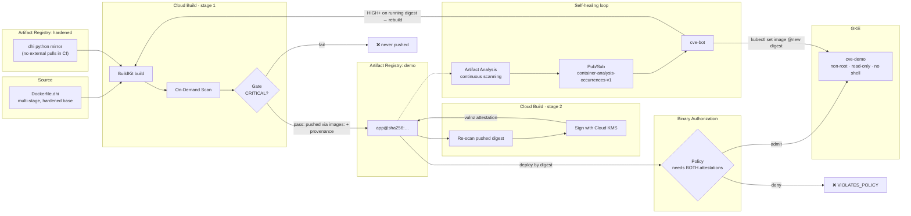

# From 400 CVEs to Zero: Hardened Containers on Google Cloud, Build to Deploy

A working demo of a container supply chain on Google Cloud that:

1. **starts from less**: the same app on a Docker Hardened Image instead of a full `python` base image,
2. **gates the build**: Cloud Build scans every image and refuses to push anything with CRITICAL findings,
3. **signs what passes**: a separate step re-scans the pushed digest and signs it with Cloud KMS,
4. **enforces at deploy**: GKE only runs images carrying **both** a Cloud Build provenance attestation and our vulnerability attestation (Binary Authorization),
5. **heals itself**: when Artifact Analysis reports a new HIGH/CRITICAL CVE on the running image, a bot rebuilds, re-scans, re-signs and rolls out a fixed image.

Everything here was run end to end on a real GCP project. The numbers below are from that run.

## What it shows

| | Old base (`python:3.13`) | Docker Hardened Image (`python:3.13-alpine3.23`) |
|---|---|---|
| CRITICAL | 8 | 0 |
| HIGH | 53 | 2 → **0 after self-heal** |
| MEDIUM | 173 | 0 |
| LOW | 191 | 2 |
| Pipeline gate | **BLOCKED**, never pushed | **PASSED**, signed |
| Shell in the image | yes, root | **none** (`exec: "sh": executable file not found`) |

| Deploy attempt | Result |
|---|---|
| Signed image from the pipeline, by digest | ✅ runs as uid 65532, read-only filesystem |
| Unsigned image pushed straight to the registry | ❌ denied by `built-by-cloud-build` **and** `vulnz-attestor` |
| Clean image signed with the **real** KMS key, built outside the pipeline | ❌ still denied by `built-by-cloud-build` |

> **About "zero":** "zero" here means zero CRITICAL/HIGH findings **that the scanner can see**. Artifact Analysis reports `Missing os-release file` for the hardened image, so OS packages may not be fully covered. Verify with a second scanner (Trivy, Grype, Docker Scout) before you quote numbers. See [docs/LESSONS.md](docs/LESSONS.md).

## Architecture



More detail, including why the pipeline is split into two stages: [docs/ARCHITECTURE.md](docs/ARCHITECTURE.md).

## Repository layout

```
app/                     Flask app; requirements.txt (fixed), requirements-v1.txt (has a known HIGH)
Dockerfile.before        python:3.13, single stage
Dockerfile.dhi           Docker Hardened Image, multi-stage (-dev to build, minimal to run)
cloudbuild.yaml          stage 1: BuildKit build → on-demand scan → gate → push (+ provenance)
cloudbuild-attest.yaml   stage 2: re-scan the pushed digest → gate → KMS sign → tag
policy.yaml              Binary Authorization: require built-by-cloud-build AND vulnz-attestor
k8s/deployment.yaml      non-root, read-only rootfs, all capabilities dropped, by digest
env.sh                   all names and regions in one place
run-demo.sh              the whole demo as 6 acts, press Enter between acts
scripts/                 setup (00–04), demo steps (10–31), cleanup (99)
docs/                    architecture, walkthrough, lessons learned
```

## Prerequisites

- A **dedicated** GCP project with billing (the Binary Authorization policy applies project-wide).
- `gcloud` (with `beta`), `docker`, `kubectl`, `jq`, `envsubst`, Go (to install `crane`). Cloud Shell has all of these.
- The `local-extract` gcloud component for local scans: `sudo apt-get install google-cloud-cli-local-extract`.
- A Docker account to pull from `dhi.io` (a read-only access token is enough).

## Setup (≈ 30–45 min, mostly waiting)

```bash
gcloud config set project <YOUR_PROJECT_ID>
source env.sh
./scripts/00-setup.sh           # APIs, Artifact Registry repos, least-privilege build service account
./scripts/01-mirror-base.sh     # docker login dhi.io, then crane-copy the hardened base images
./scripts/02-binauthz.sh        # KMS key, Container Analysis note, attestor, initial policy
./scripts/03-cluster.sh         # GKE Standard with Binary Authorization enforcing
./scripts/20-pipeline.sh        # first builds (creates the built-by-cloud-build attestor)
./scripts/04-policy-strict.sh   # require BOTH attestations
./scripts/22-deploy-signed.sh   # deploy the signed image
```

## Run the demo

```bash
./run-demo.sh        # all six acts
./run-demo.sh 3      # start from act 3
```

| Act | What happens | Script |
|---|---|---|
| 1 | Same app, two bases: scan, size, shell vs no shell | `10-demo1-scan.sh` |
| 2 | Both images through the same pipeline: hardened is signed, old is blocked | `20-pipeline.sh` |
| 3 | Deploy the signed image by digest; no shell to exec into | `22-deploy-signed.sh` |
| 4 | Unsigned image pushed by hand → denied | `21-bypass.sh` |
| 5 | Clean image signed with the real key, built off-pipeline → denied | `21b-laptop-signed.sh` |
| 6 | A HIGH CVE on the running image → bot rebuilds, re-signs, rolls out | `30-cve-bot.sh`, `31-simulate-cve.sh` |

Step-by-step explanation of every command: [docs/WALKTHROUGH.md](docs/WALKTHROUGH.md).

> Act 6 replays a **real** Artifact Analysis occurrence for the running image onto the Pub/Sub topic, because you can't schedule a CVE disclosure for a demo. In production, the same loop is triggered by the real notification.

## Cost

While the 2-node cluster runs, expect roughly **US$3–5/day** (mostly GKE nodes). Scans and builds are charged per run. To pause cheaply:

```bash
gcloud container clusters resize cve-demo --zone asia-south1-a --num-nodes 0 --quiet
```

## Cleanup

```bash
./scripts/99-cleanup.sh
```

Deletes the cluster, repositories, Pub/Sub subscription and attestor, destroys the KMS key version, and resets the Binary Authorization policy to allow-all.

## Not production-ready as-is

The patterns are production patterns. The scripts are demo scripts. Before using this for real:

- run the bot as a Pub/Sub-triggered Cloud Build or Cloud Run service, with rate limits;
- send anything beyond a patch-level fix through a pull request, not straight to prod;
- scope IAM further (per-repo bindings, separate signer identity);
- add continuous validation and alerting on Binary Authorization denials.
