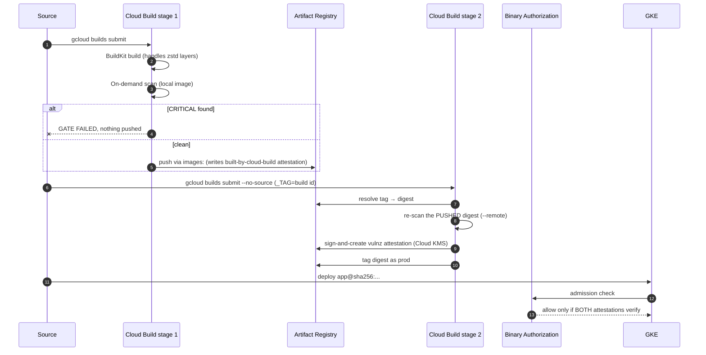
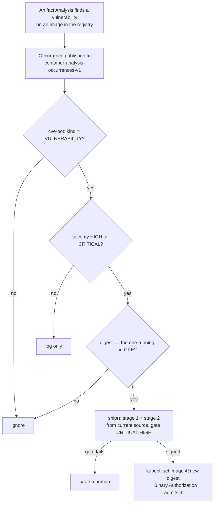

# Architecture

## The control chain

| Layer | Control | Google Cloud service | What it stops |
|---|---|---|---|
| Base image | Start from a minimal, hardened base | Docker Hardened Images, mirrored into Artifact Registry | Hundreds of inherited CVEs, shells and package managers |
| Build | Scan and fail on CRITICAL | Cloud Build + On-Demand Scanning | Known-bad images ever reaching the registry |
| Provenance | Image must be built by the pipeline | Cloud Build `built-by-cloud-build` attestor | Images built on a laptop, even if signed |
| Signature | Image must pass the vulnerability gate | Cloud KMS + Binary Authorization attestor | Images that skipped or failed the scan |
| Admission | Both attestations, by digest | Binary Authorization on GKE | Anything not built **and** approved by the pipeline |
| Runtime | Non-root, read-only, no capabilities, no shell | GKE pod `securityContext` + distroless runtime | Easy post-exploitation |
| Day 2 | React to new CVEs on running images | Artifact Analysis → Pub/Sub → bot | "Zero" silently rotting into "not zero" |

## Why two pipeline stages

1. **Provenance only exists if Cloud Build pushes the image itself**, through the `images:` field. That push happens after all build steps finish, so the signing step can't run inside the same build.
2. **The signer should not trust the builder's word.** Stage 2 scans the exact digest in the registry before signing it. If stage 1 is ever bypassed or compromised, stage 2 still refuses to sign a bad image.

## Self-healing loop

## IAM for the build service account

| Role | Why |
|---|---|
| `roles/artifactregistry.writer` | push images |
| `roles/artifactregistry.repoAdmin` (on the `demo` repo only) | move the `prod` tag to a new digest |
| `roles/storage.objectViewer` | read the uploaded build source from the Cloud Build bucket |
| `roles/logging.logWriter` | write build logs (`CLOUD_LOGGING_ONLY`) |
| `roles/ondemandscanning.admin` | run on-demand scans |
| `roles/binaryauthorization.attestorsViewer` | look up the attestor |
| `roles/cloudkms.signerVerifier` | sign with the KMS key |
| `roles/containeranalysis.notes.attacher` | attach attestations to the note |
| `roles/containeranalysis.occurrences.editor` | create the attestation occurrence |

The Binary Authorization service agent also needs `roles/containeranalysis.notes.occurrences.viewer` to read attestations at admission time.
